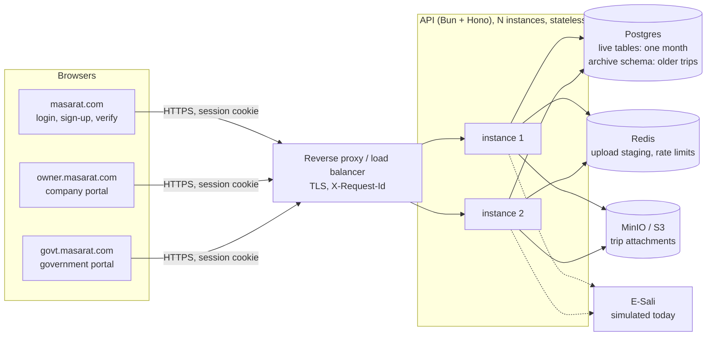
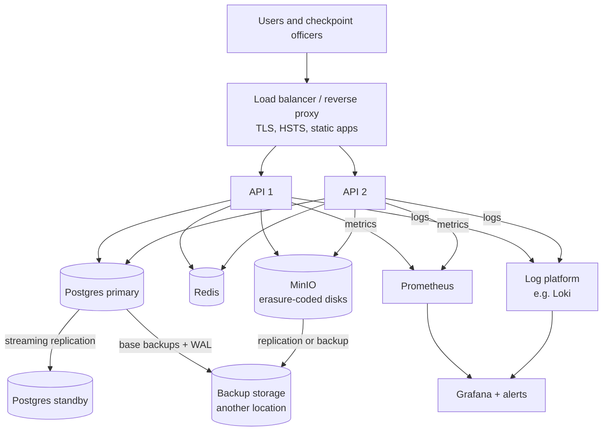

# Architecture

How Masarat runs: what each part does, what it keeps, and how the parts scale. For the hardware each part needs, see [sizing.md](sizing.md); for what must be done before going live, [predeployment-checklist.md](predeployment-checklist.md).

## The system now

| Part                      | What it is                                                                                                                                               | What it keeps                                                                                                                                               | How it scales                                                                                                                     |
| ------------------------- | -------------------------------------------------------------------------------------------------------------------------------------------------------- | ----------------------------------------------------------------------------------------------------------------------------------------------------------- | --------------------------------------------------------------------------------------------------------------------------------- |
| **Three web apps**        | Static React builds (Vite): `apps/site`, `apps/owner-portal`, `apps/govt-portal`                                                                         | Nothing. Each portal caches what it read for a minute (TanStack Query) and keeps list settings for the tab's session                                        | Any static host or CDN                                                                                                            |
| **API**                   | One Hono app on Bun (`apps/api`)                                                                                                                         | Nothing of its own: sessions, data and files live in Postgres, Redis and MinIO. Exports are built on the instance's temporary disk within their own request | More instances behind the proxy. The jobs that must run once (session purge, upload sweep, archive) take a Postgres advisory lock |
| **Postgres 18**           | Every record: accounts, sessions, login attempts, companies, fleet, trips, bills, payments, certificates, the people registry, the daily revenue summary | **Live tables** hold about a month of trips (`HOT_DAYS`); finished older trips move to the **`archive` schema** every night. The `all_*` views read both    | Vertically. A standby replica for failover; a read replica only if monitoring asks for one                                        |
| **Redis 7**               | Shared, short-lived state                                                                                                                                | Upload staging tokens (24 h) and the public verify page's per-IP rate limit. Losing it costs at most an upload to redo                                      | One small instance; no persistence needed                                                                                         |
| **MinIO (S3-compatible)** | Trip attachments                                                                                                                                         | `documents/<upload day>/<token>.<ext>`; the row in `trip_documents` holds the key                                                                           | Disks, or a tier for objects older than the live month                                                                            |
| **E-Sali**                | Bill IDs and payment status                                                                                                                              | Simulated (`services/esali.ts`) until its documentation arrives                                                                                             | —                                                                                                                                 |

### One request

1. The browser calls `api.masarat.com` with its session cookie. The proxy adds or passes `X-Request-Id`.
2. **Middleware**, in order:
   - request id and access log
   - security headers
   - CORS
   - the Origin check on anything that changes data
   - the body size limit
   - the session lookup (Postgres)
3. **The route**:
   - checks the permission
   - validates the body or query against its zod schema (`@masarat/shared/schemas`)
   - calls a service with the account's company and branch scope
4. **The service** reads and writes Postgres as `masarat_app`, a role that can't change the schema. Reads that may reach archived trips use the `all_*` views; writes only touch the live tables.
5. **The reply** is JSON `{ ok, data | error }`, or a file streamed from MinIO.
6. **The log**: one JSON access line with the request id, route, status and duration. Anything logged while handling the request carries the same id.

### Background jobs (in every API instance)

| Job              | Every                        | Runs on                      | Does                                                                             |
| ---------------- | ---------------------------- | ---------------------------- | -------------------------------------------------------------------------------- |
| `sessions.purge` | hour                         | one instance (advisory lock) | Deletes expired sessions                                                         |
| `uploads.sweep`  | day                          | one instance                 | Deletes uploads of two days ago that no trip uses                                |
| `trips.archive`  | hour, works 01:00–05:00 only | one instance                 | Moves finished trips older than `HOT_DAYS` to the archive, 5,000 per transaction |
| `logs.cleanup`   | day                          | every instance               | Deletes its own log files older than `LOG_RETENTION_DAYS` (7)                    |

### Data lifecycle

- **A trip**:
  1. It's live from booking until a month after departure.
  2. Once it's finished (authorized, cancelled, or a draft untouched for 30 days), the nightly job moves it, with its items, passengers, tax lines, payment, certificate and attachment rows, into `archive.*`.
  3. It stays readable everywhere: the trips list for an older period, its page (read-only, marked archived), the government search and exports, the verify page and the fleet's trip counts.
  4. Nothing is deleted. How long the archive keeps trips is the agency's legal decision.
- **The daily revenue summary** covers all history and is never archived.
- **Attachments** stay in MinIO under the same key. A lifecycle (tiering) rule can move objects older than 30 days to cheaper storage.
- **Logs**: 7 days on each instance's disk. Before deployment they also go to the log platform (see the checklist).

### Security boundaries

- **Accounts.**
  - Passwords are hashed with Argon2id.
  - The session token is random; only its SHA-256 is stored. Sessions end after 2 h idle or 12 h in all.
  - Login is limited per username and per IP (in Postgres).
  - There is exactly one government admin, created once at deployment.
- **Requests.**
  - Anything that changes data needs an Origin from the three web apps. CORS allows exactly those.
  - Every body and query is checked against its schema.
- **The database.** The API's role can read and write rows, not change the schema. Every company query is scoped to the member's company or branch.
- **HTTP headers.** Responses carry HSTS (over HTTPS), `nosniff`, `frame-ancestors 'none'` and `no-referrer`.
- **The public verify page.** It shows no names or IDs, and is limited to 60 checks a minute per IP, shared across instances through Redis.

## Recommended production layout

- **Two API instances**: for availability, not speed. One instance on 2 vCPUs carries the core flow at several times the target load (see sizing).
- **Postgres**: a primary and a standby with streaming replication.
  - The archive schema sits in a tablespace on larger, cheaper disks.
  - A separate archive server is possible later. The `all_*` views then become a foreign-data link or the API reads two connections; it isn't needed at these volumes.
- **MinIO** with erasure coding on its own disks. Attachments are the largest data by far (see sizing).
- **Monitoring before go-live**: Prometheus and Grafana, plus the log platform.
- **Later, when the numbers ask for it.** Monitoring decides; none of these is needed at the measured volumes:
  - a worker fed by RabbitMQ for reports, exports and archived PDF copies of issued documents
  - a read replica for the dashboard
  - PgBouncer
- **Not recommended: Cassandra or another NoSQL store.** The data is relational and transactional (bills, payments, taxes) and small, and Postgres holds it with room to spare.
